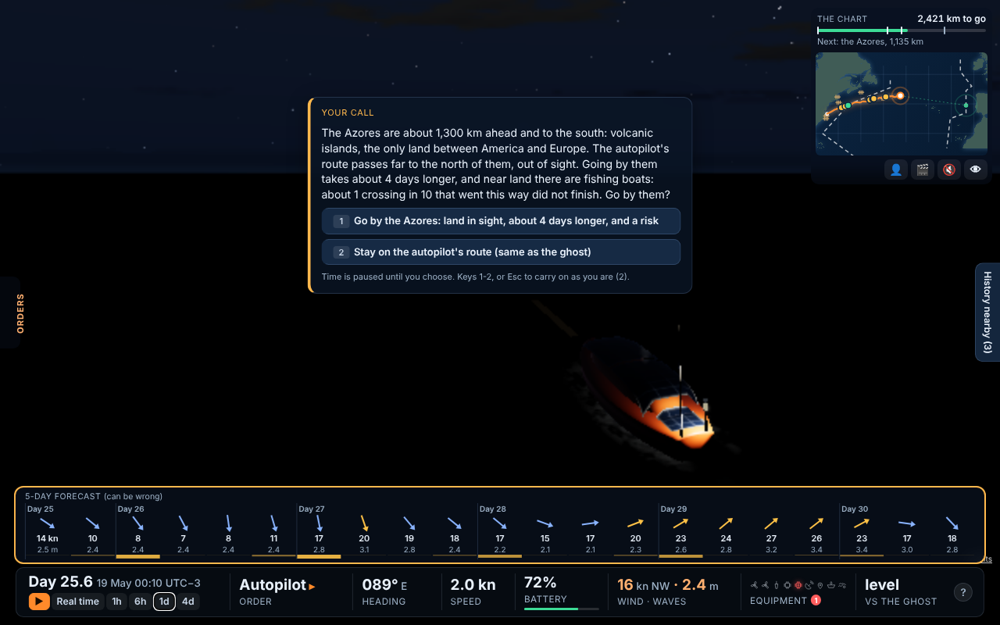
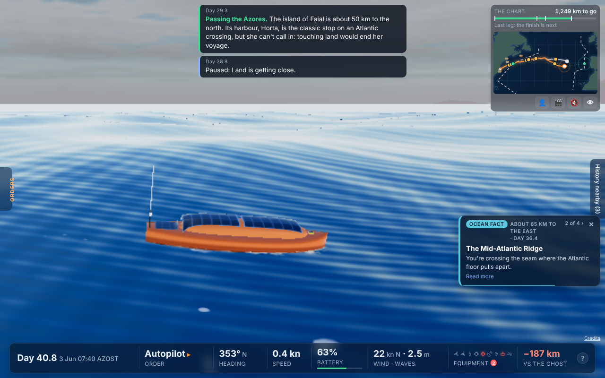

# Going by the Azores (24 Nov 2026)

John, 24 Nov 2026: "There doesn't seem to be enough land. You are just floating in the middle of
water the whole time." Asked which land to add to the crossing itself, he chose "Azores and a dock
in Portugal". The dock is in `portugal-dock-2026-11.md`. This note is the Azores.

## Why she never saw them

The autopilot's route is the great circle (the shortest line on a globe) from the drop point to the
finish. It peaks near 42.6N and passes 160 to 500 km north of the islands. It was chosen on purpose:
in the Nov 2026 sensitivity study the straight route finished 72 voyages in 100 against 56 for a
dog-leg south of the Azores (`runner/simulate.py`, `default_mission`). So the islands cannot simply
be put on everyone's route. They are offered as a choice, with its price told.

## What changed

Once a crossing, in mid-ocean (between 44W and 36W, about day 25), a "Your call" card asks whether
to go by the Azores. Yes hands her to the autopilot with two marks on its planned route, then the
finish as ever:

| Mark | Where | Why there |
| --- | --- | --- |
| 1 | 38.30N 32.50W | Open water 120 km south of Flores, so the turn in is made clear of Flores and Corvo |
| 2 | 38.10N 28.35W | 30 km south of Pico's shore, its 2,351 m mountain 41 km to the north. Outside the base station's 20 km land margin, so base still routes her to it |

- It is a real order (`"azores"`, `src/boatsim/sandbox/helm.py`). The simulator sails it in the real
  weather with the autopilot's own power management and base's daily re-planning, exactly as on the
  straight route. Nothing is faked: the days it costs and the boats it loses are the simulator's.
- **The finish rule is untouched** (John, 9 Nov): the race's line, 39.5N 13.5W. Landfall anywhere,
  the Azores included, still ends the voyage.
- The order is refused east of 33W, where the straight line to the mark off Pico could cross Faial
  or Pico. The card is only shown west of 36W.
- From base (steering by satellite) the same order uplinks the marks as waypoints, like any route.
- A share link or a saved voyage sails it again (the order is in the saved orders).
- Not asked in a challenge (its start, goal and stars are its own), nor on a voyage that does not
  finish on the usual line, nor when her link to base is dead.
- The game side: `sea3d/src/helm/azores.ts` (when to ask, the words, the measured numbers), the
  call in `decisionDue` and `goByAzores` in `sea3d/src/helm.ts`. The status says `via_azores`.

A first version steered her to the marks as a plain heading order at fixed power. It cost 7 to 22
days on three test launches, almost all of it from leaving the autopilot (a plain "aim at the
finish" order from the same spot cost as much, with no detour). So the order became the autopilot's
own route by the islands.

## What it costs (measured)

`tools/azores_pass.py` sailed all 91 launch days of April to June 2020 twice in the game's own
simulator with the browser's weather: on the autopilot all the way, and with the order given at
42W. Every voyage is in `docs/qa/data/azores-pass-2026-11-24.jsonl`.

| | Autopilot's own route | By the Azores |
| --- | --- | --- |
| Launch days where she reached 42W with a working link and took the order | 71 | 71 |
| Finished | 64 | 58 |
| Lost (broke down, taken or snagged by fishing boats) | 5 | 9 |
| Ran aground | 0 | 1 |
| Disqualified (out of time) | 1 | 2 |
| Left the weather data | 1 | 0 |
| Still at sea when the year's weather ran out | 0 | 1 |
| Nearest to Pico's summit, median | 366 km (162 to 501) | 41 km (39 to 43, of those that finished) |

- **Days:** on the 58 launch days that finished both ways, going by the Azores took a median of
  3.9 days longer; 8 in 10 fell between 1.3 and 7.0 days; the least was 0.7 and the most 10.3.
- **Risk:** of the 64 crossings the autopilot's route finished, 6 did not finish by the Azores
  (about 1 in 10): five were "taken or snagged by fishermen" (two of them on the way in, still
  150 km from Pico), one was disqualified, out of time. The simulator
  puts that risk at 1% a day within 150 km of any land (`vessel/hazards.py`, from the race's own
  record: 4 boats taken in 215 boat-days near land), and she spends about a week that close to the
  islands. The one grounding (13 May) was a boat the autopilot's route also lost.
- No crossing that failed on the autopilot's route was saved by going by the Azores.
- On the other 20 launch days the order never applied: her link to base was already dead at 42W
  (13), when the game does not ask, or she was lost before she got there (7).

**The default launch day is one of the six.** On 23 April 2020, the day a first game sails, going
by the Azores gets her taken by fishermen on day 41.8, two and a half days after Pico comes into
view. On the autopilot's route that day she finishes in 54.4 days. The dice are fixed by the launch
day, so it happens every time. This is put to John as a choice (see the PR).

So the card says: about 4 days longer, and about 1 crossing in 10 that went this way did not finish.
The small print gives the spread honestly: most took 1 to 7 days longer, the worst 10.

## Played in the browser

`sea3d/tools/qa/azores-call.mjs` plays the default crossing in a headless browser with the real
simulator (Pyodide), says yes to the call and Esc to every other card. Log:
`docs/qa/data/azores-call-2026-11-24.log`.

| Check | Result |
| --- | --- |
| The call comes in mid-ocean | Day 25.6, at 42.76N 42.50W, "about 1,300 km ahead" |
| Saying yes | The order cell stays "Autopilot"; the status says she is going by the Azores |
| Pico's land comes into the picture | Day 39.8, 31 km from the edge of its land files (the page looks every two days of game time) |
| Nearest to the edge of Pico's land seen by the script | 31 km |
| She finishes | No: taken by fishermen on day 41.8 (the default day, as above) |
| She finishes | Expected no on this day, so the script exits 1 here; that is the measured loss, not a fault |
| Unit tests (`npm run test:unit`) | 686 pass before, 688 after (two new) |
| Simulator tests (`tests/test_sandbox_helm.py`) | 53 pass before, 56 after (three new) |

The card and Pico on the horizon, both taken after the review's fixes,
cloud pictures in software graphics at Low:

## After an independent review (24 Nov)

A second reader went through the change and found these. All are fixed on the branch, and the table
above is the measurement run again after the fixes.

| Finding | Fix | Numbers before, after |
| --- | --- | --- |
| A daily message from base already on its way still carried the old route, so for up to two days after the order she was steered back to the straight line | `_route_auto` rewrites the messages still on their way to the new route, each at its own time | Median extra days 4.1, now 3.9; 8 in 10 between 1.3 and 7.4, now 1.3 and 7.0; most 10.6, now 10.3. Finished 58 both times; the same six launch days fail |
| Taking the helm, sailing east of 33W and handing back to the autopilot could send her at a mark with an island in the way | `_azores_route` keeps a mark only if the straight line to it is open water (`open_water_km`); if none is left she goes straight for the finish | New test |
| A saved or shared voyage loaded with the order shown as "Steering NaN" | The page reads an "azores" order as "Autopilot" on load | Type check and unit tests |
| The card said "1 to 7 days" as if that were the whole range, and "lost there" for boats that include one out of time and two taken on the way in | The small print now says most took 1 to 7 days longer and the worst 10; the card says "did not finish" | Words only |
| A bad sail or engine setting was refused after the route had already been changed | The order checks them first | New test |
| Power pushed up before the order stayed up afterwards | `goByAzores` puts the power back as any return to the autopilot does | By reading |

Known and left: a player who says no, saves, and loads again west of 36W is asked once more.

## Not done, not measured

- Nothing on a real graphics card. Pico's land is the same that `voyage.html?place=pico` has always
  drawn; here it loads in mid-voyage, when she comes within 50 km of its files.
- Only 2020's weather (the browser's bundle), and only our kayak. A sailing boat tacks, and may
  pass the marks differently.
- There is no way to call the detour off once taken, short of steering yourself.
- The chart does not draw the two marks.
