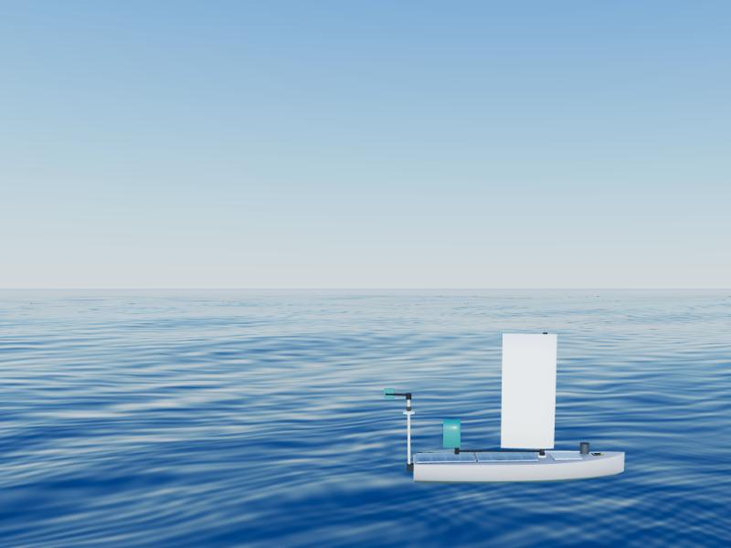
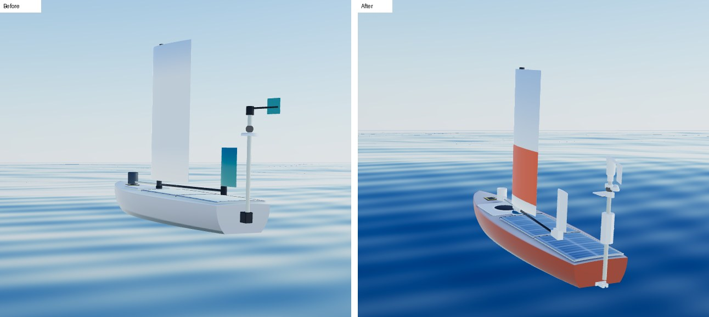
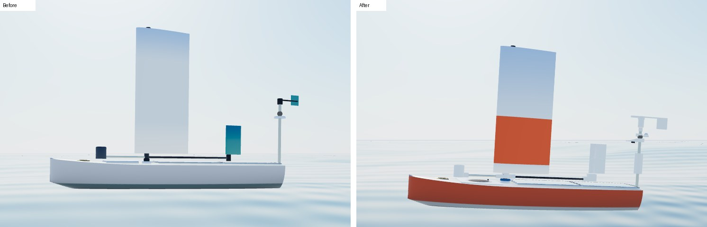
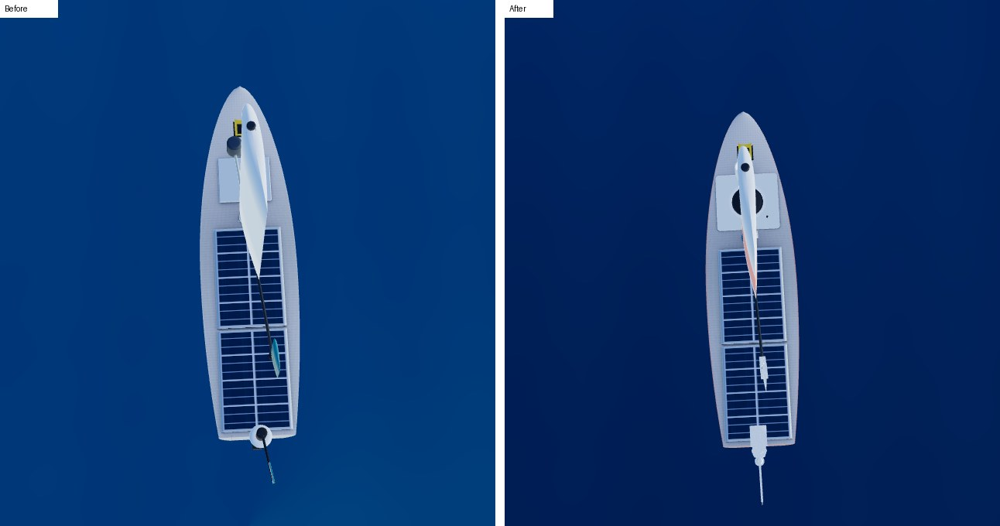
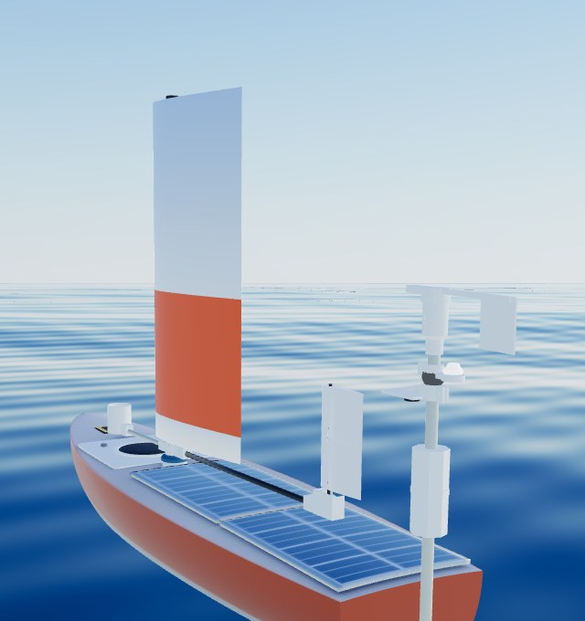
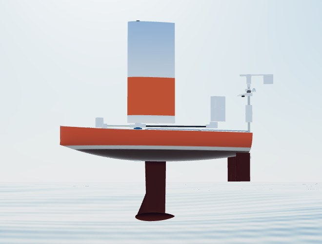
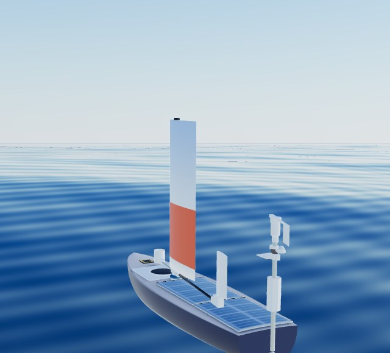
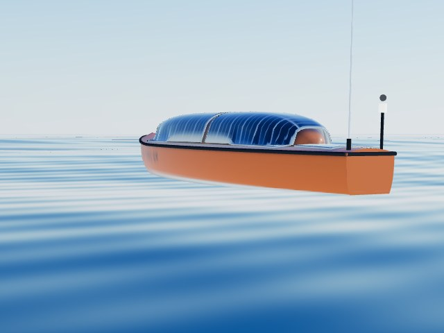

# How the Randolph boat looks, and honest pictures from the cloud

24 Nov 2026. John asked whether the boats should be redone in Blender because the pictures he
had been shown looked blocky. Three findings, and what changed.

## 1. The boats were already Blender models, and already smooth on a real card

Every boat has been built by a Blender script since 10 and 11 Nov (`sea3d/blender/`, PRs #150,
#152, #185, #230). The blocky pictures came from a cloud browser. A cloud sandbox has no graphics
card, and when the pages see software drawing they draw at 0.5 to 0.6 of full size with edge
smoothing off (`softwareGraphics()` in `sea3d/src/atmosphere.ts`), so every edge is a staircase.
On John's PC (GTX 1660 Ti) the live Boatyard reported `antialias: true`, 4 samples, and loaded
`models/randolph.glb` and `models/kayak.glb`; its picture is smooth:



**For pictures from the cloud, add `?gl=full` to the page address.** It was already there
(`softwareGpu()`), and asks for the picture a real card draws: full size, edges smoothed. It is
slow (the Boatyard at Low draws about a frame a second) but right. The new script does it for you:

```
cd sea3d && npm run dev &
node tools/qa/boat-look.mjs revc kayak        # side, quarter, bow and above, panels hidden
VIEW=lifted SHOTS=quarter node tools/qa/boat-look.mjs revc
PAINT=navy SHOTS=quarter node tools/qa/boat-look.mjs revc
```

It waits on drawn frames, not on seconds, so it works at any speed. Every picture below was
taken with it (`QUALITY=low`, which changes the sea and the page's resolution rules, not the boat).

## 2. What was really weak: our Randolph boat

The kayak looked good. Our model of the Randolph boat did not: a white hull, a blank white wing,
and boxes and discs standing in for the fittings. It was also out of date. Their own files say
the real boat is hi-vis orange, and they publish every part in 3D:

- Their viewer (`build-files/viewer/`, version E3 of 23 Nov, commit 24cb8fe) paints the hull
  hi-vis orange `#ff5b12` over a white boot stripe and dark red antifouling `#5a1712`.
- `docs/Launch_Plan.md`, "Labels and marking": "fluorescent orange deck and wing panels", the
  wing's on "both faces of the wing ... lower half, so it reads with the boat heeled"
  (`build-files/source/drawings.py`).
- The wing is a foam core with a glass skin and ply end caps, so a plain smooth wing is right.
  We did not add ribs or cloth detail: that would have been invented.

### What changed

- **Colours** (`build_randolph.py` PAINT, `paint.ts` BUILT, the drawn-in-code boat in
  `model.ts`): hi-vis orange topsides, white boot stripe, dark red bottom. The deck stays light
  grey, as their viewer draws it (their launch plan says orange deck; we followed the newer
  picture). The keel, bulb, weed fairing and rudders are in the bottom paint, under a material
  named `antifoul`, so a Boatyard paint scheme recolours them with the bottom.
- **Wing**: white, with a hi-vis orange panel on the lower half of both faces. GUESS: the
  panel's exact edges (60 to 360 mm up the wing). No lettering, as before: it is our model.
- **Fittings**: their own shapes in place of our stand-ins. `sea3d/scripts/randolph_fittings.py`
  reads their `model.json`, takes 22 outside parts, thins each from 5 to 18 thousand triangles
  (they are print-ready) to a few hundred, and writes `sea3d/blender/randolph_fittings.json`
  (98 kB, kept in git, so the site build needs nothing from their repo). Stern post: transom
  bracket, radar reflector, antenna platform, GPS puck, light clamp and lens, sensor cap,
  wind-vane housing and arm. Deck: hatch lid, the satellite modem in its bowl, test valve, pump
  outlet. Wing: spar clamp, tail servo housing, the two-part tail fin, counterweight pod.
  Under water: weed fairing, the printed rudder (one, on the centreline; the Boatyard still
  copies it for the twin). MIT licence, credited in `THIRD_PARTY_NOTICES.md`.
- Left out on purpose, because each material and moving group is one more thing to draw every
  frame: the membrane vent, tail detent, the lead inside the pod, the rod inside the tail fin,
  and everything inside the hull.
- The navigation light moved 45 mm aft to where their clamp holds it, and the comms status lamp
  moved to the forward end of the antenna platform, clear of the clamp (the independent review
  found the clamp would have hidden most of it).
- Two orange boats: her hull is now close to the kayak's orange. On charts she keeps her teal
  track colour (`specs.ts`), and in 3D her wing sets her apart, so nothing else was changed.
- Every hook the game uses is kept: `wing_pivot`, `vane_pivot`, `rudder_pivot`, `tail_flap`,
  `panel_*`, `hull`, `keel`, `bulb`. The Boatyard's twin rudder, YB3 tracker and thruster dress
  work as before, and so do heel, pitch and repaint.








The model shown for Rev B and Rev C5 is the same one (it always was): it now carries the
current boat's fittings, so Rev B shows parts it did not have. The wing is still the Rev C5
wing our numbers describe.

## 3. Two drawing faults the orange hull showed up

- **A coloured hull went brown in shade.** `skyShade` (`finishes.ts`) took half the colour out of
  the sky's light on a hull so that white topsides would not read blue. It did that to the lit
  paint, not to the light, which is the same thing on white but greys any colour. The first
  orange Randolph hull drew as brown, about (125, 84, 80) on screen. The paint's own colour is
  now divided out first and put back after, so a pure white or grey hull draws exactly as before
  (the sum is the same when red, green and blue are equal; the stock boats' off-whites move by a
  hair) and a coloured hull keeps its colour in shade: about (200, 70, 40). This changes every
  coloured hull, not only this one: the kayak's shaded side, the stock boats' navy stripes and
  bottoms, and any boat painted navy, green or red in the Boatyard are a little more saturated in shade.
  The kayak, checked from two sides after the change, looks as it did:

  

- **Specks on the wing.** The dark spar inside the wing showed through the skin as a dotted
  line. The spar is now drawn only where it can be seen (below the wing, and a stub above).

## Cost

| | Before | After |
|---|---|---|
| `randolph.glb` as fetched (Draco, then gzip) | 132 kB, 99 kB | 156 kB, 122 kB |
| Meshes drawn (each one draw, two with shadows) | 23 | 21 |
| Triangles | 44,978 | 49,221 |
| Materials | 14 | 14 |

The file is fetched only when a page first shows the Randolph boat, never on the title. Fewer
meshes because parts of one material that move together are joined (spar and boom; all the
white prints on the stern post). The new materials (`antifoul`, `asa`, `petg`, `wing_hivis`)
take the same finishes as ones they replace (`fin`, `lead`, `teal`, `weight`), so no new kinds
of shader. The `skyShade` change edits a shader that was already there.

The speed guard (`npm run test:speed`) could not be run in the thread sandbox: its sailing
screen needs the simulator from a CDN the sandbox cannot reach, and the guard has no
`PYODIDE_DIR` switch as `smoke.mjs` has. The PR's fast gate runs it on GitHub.

## Checks

- `npm run test:unit`: 672 pass, 4 of them new (`tests/randolphLook.test.ts`: the colours agree
  in the build, the repaint table and the drawn-in-code boat; the fittings file is whole, on the
  boat, under 9,000 triangles, in at most 8 groups, with the rudder on the centreline).
- `tools/build_site.sh`: builds, all 12 models compress (12.1 MB to 2.3 MB).
- Not done: a look on a real graphics card after the change. The pictures here are the cloud
  browser's with `?gl=full`. After the deploy, open the Boatyard, pick Rev C5, and compare.

## When their boat changes

```
git clone --depth 1 https://github.com/sheltonr2/drone-boat /tmp/drone-boat
python sea3d/scripts/randolph_fittings.py /tmp/drone-boat/build-files/viewer/model.json
python sea3d/blender/build_randolph.py sea3d/public/models/randolph.glb
```

The script stops if a part it expects has gone from their model. A part that moved comes
through in its new place. New parts need a line in its `PICK` table.
