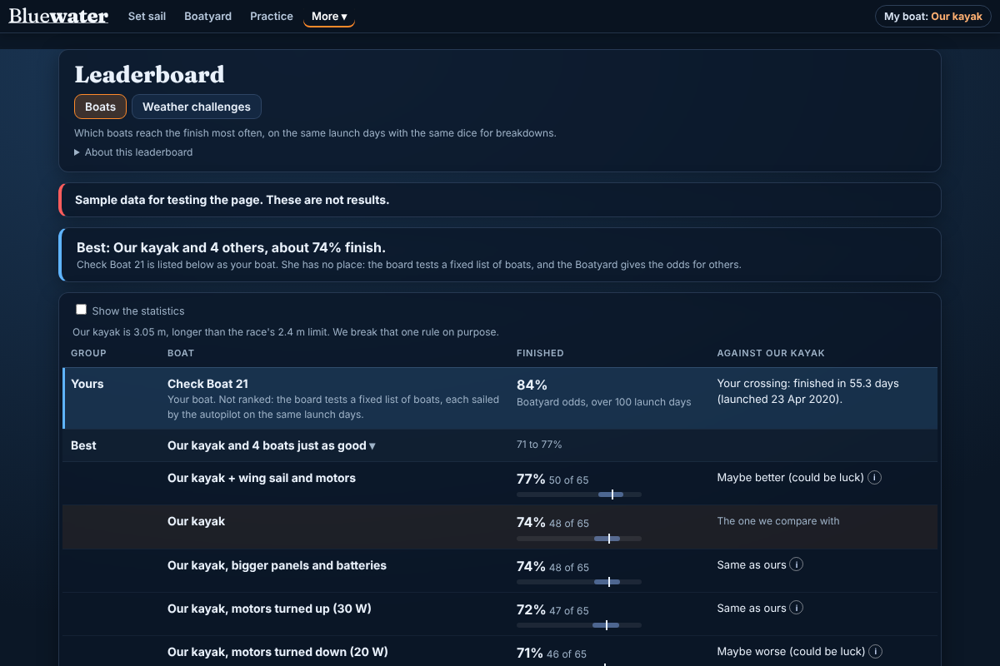

# A built boat under her own name on Results and the leaderboard (issue #653)

21 Nov 2026. Found by a play-through of the live site on John's PC: a boat built and named in
the Boatyard ("Check Boat 21") carried into the crossing, but the Results card said "Our kayak
finishes 84% of launches" and the leaderboard had no row for her. That was the last unmet part
of the Boatyard's "done when".

## Cause

- Results picked the name from the boat's base: any design built from our kayak was called
  "Our kayak", whatever the player had named it (`showStanding` in `sea3d/src/helm.ts`).
- The leaderboard only ever lists the fixed set of boats our servers rank. Nothing recorded
  that the player had sailed a boat of their own.

## What changed

- **Results** uses the name the boat sailed under (the one on the Set sail card): "Check Boat
  21 finishes 84% of launches. This was one of them." Her row in the Details table reads
  "Check Boat 21 (you)". Our kayak itself still reads "Our kayak" and "You".
- **The crossing is remembered in this browser** when it ends (`sea3d/src/myCrossing.ts`):
  the boat's name, the simulator's id for the build, whether she finished, the days, the
  launch day. Not for a weather challenge (those have their own tab) and not for someone
  else's shared voyage. Nothing leaves the browser.
- **The leaderboard** shows that boat in a row of her own at the top, marked "Yours": her
  name, the Boatyard's odds for the build when our servers have tested it, and how the
  player's crossing ended. If the build is one the board already ranks, that row is marked
  and carries her name.
- The Results line "Not on the leaderboard yet" now reads "Not one of the boats the
  leaderboard ranks", which is what was always meant.

(The picture uses the sample board, which is why it carries the red "sample data" banner.)

## Why she has no place (realism)

The board ranks boats sailed by the autopilot on the same 65 or so launch days. One voyage
steered by a player is a different test, and the Boatyard's odds come from other launch
days. Giving her a rank from either would be a made-up number, so the row says "Not ranked"
and says why.

## How it was checked

- `npm run test:unit`: 634 pass, with new `tests/myCrossing.test.ts` (the sentence from the
  live check; the stored crossing read back and rubbish dropped; the leaderboard row with and
  without odds).
- `SMOKE_PART=2 npm test`: passes, with a new step: a stored crossing puts the boat's name in
  the first row of the leaderboard, as text and not as HTML, with "Not ranked" and the days.
- By eye on a local build (the picture above).

## Not checked here

A full crossing to the Results card needs the simulator files, which the cloud test build
does not have. The name on Results is covered by the unit test of the sentence and by
reading the code; it wants one look on the live site after the deploy.

## Not in this change

The smaller thing in the issue (a Watch link in the Boatyard's table loses its replay if it
opens in the same tab) and the table's "Planned / Yours" column heads are left as they are.
