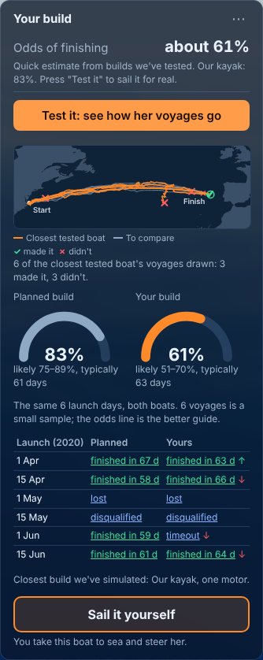

# Boatyard "Test it": a chart, gauges and "Sail it yourself" (issue #332)

21 Nov 2026. From Leo's usability review, item 8: the Boatyard's test was a timer line and
then a text table, with no way on to sailing the boat you had just built.

## What changed

- **A chart in place of a bare timer.** Pressing "Test it" puts a small chart of the North
  Atlantic in the "Your build" card. Each voyage's track is drawn on it as that voyage ends,
  from the start to where it ended, with a green tick if it reached the finish and a red cross
  if it didn't. Your boat is orange; the boat it is compared with (the planned kayak, or a
  Randolph boat as built) is grey-blue underneath. One line under the chart counts them
  ("4 of 6 of your voyages drawn: 3 made it, 1 didn't."). The status words and the clock stay,
  under the chart, so a long run in the browser still never looks frozen.
- **Two gauges.** The planned-versus-yours odds are now two half-circle gauges with the
  number in the middle. The launch-by-launch table with its Watch links is still there, below.
- **"Sail it yourself".** A big button under the result. It saves the tested design as your
  boat (the same save as "Save as my boat", with the name you typed, or "My kayak" and the
  like if you typed none) and opens the sailing screen, where she is the boat on the Set sail
  card. If a different boat was saved before, the line under the button says she will be
  replaced. The button is only there while the result is: change a part and both go, so the
  boat you sail is always the one you tested.

## Where the picture comes from (nothing is faked)

- Tracks are the simulator's own positions: the `lat` and `lon` lists in each voyage replay
  (schema 1, docs/boatyard.md). The tick or cross is the replay's own `outcome`.
- With the simulator in the browser, a voyage is drawn the moment its worker finishes it
  (`OnVoyage` in `sea3d/src/yard/launch.ts`). With results from our servers (the grid, or the
  Randolph boats' as-built replays) the voyages all exist already, so they are fetched (about
  17 KB each) and drawn a fifth of a second apart.
- The land is the same mask the sailing screen's chart uses (`public/land.png`).

## Code

- `sea3d/src/yard/launchChart.ts`: the chart (a 2D canvas) and the gauge (SVG). No three.js,
  no new shaders or draw calls, so the speed guard's counts are unchanged; it only guards the
  title, the sailing screen and the replay in any case.
- `sea3d/src/boatyard.ts`: wiring, `sailItYourself()`.
- `sea3d/src/yard/launch.ts`: `OnVoyage`, `trackOf`, an optional `track` on a `LaunchReplay`.

## How it was checked

- `npm run test:unit`: 638 pass, including the new `tests/launchChart.test.ts` (every
  published voyage starts and ends on the chart; only a finish gets a tick; the gauge
  never overfills).
- `SMOKE_PART=2 npm test`: passes. New steps: a "Sail it yourself" button after a test; the
  Rev C test draws its voyages on the chart and shows gauges; pressing the button opens
  helm.html with that exact design saved as the player's boat (hash, base, parts) and the
  picture quality carried over; a part swapped mid-test shows no result and no button.
- By eye at 1400x900 on a local build, with the grid's results (the screenshot above).

## After an independent review (21 Nov)

A fresh reviewer read the change. Fixed from its findings:

- **A part swapped while the test was running** left the old design's result under the new
  design, with a "Sail it yourself" button that would have saved and sailed the new, untested
  one. The test now remembers which design it is testing. If the design on the stand is a
  different one when the test ends, no result is shown; the card says "You changed the boat
  while she was being tested ... Press Test it again". The button also re-checks before saving.
  A track still being fetched for an earlier test can no longer land on a later chart.
- **After a crash of the simulator in the browser** the result comes from our servers, but
  tracks already drawn live stayed. The chart now keeps only voyages that are in the final
  result with the same ending.
- **Two published voyages ended east of the chart's edge** (the Pearson 31-2 with a wind vane,
  lost in the Bay of Biscay at 1.9 W), so they got no cross. The chart now runs to 0 degrees,
  and the unit test checks every published voyage (486 under `public/boatyard`, plus
  `public/voyages`), not one build.
- **The orange tracks were called "Yours" even when they were the closest tested build's**
  (results from our servers for a design they haven't sailed). The key and the line under the
  chart now say "Closest tested boat" then. The browser's own runs are always yours.
- Each voyage file was fetched twice on the servers' path; now once. The "To compare" key
  only shows when there is a boat to compare with.

Left for later: if the browser won't store anything (private mode), the boat is kept for
this page only, so the sailing screen opens with our kayak; and the tally and status lines
are not announced to screen readers as they change.

## Not checked here

- The live draw with the simulator in the browser (tracks appearing one by one over a few
  minutes). The cloud test build has no simulator files, so only the all-at-once path ran.
  Worth a look in Nina's live sweep after the deploy.
