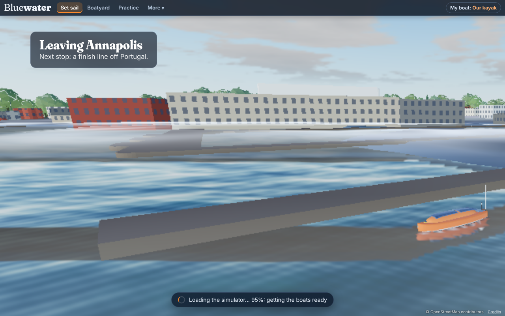

# Launching from the dock, 24 Nov 2026

## Why

John, 24 Nov 2026: "There doesn't seem to be enough land. You are just floating in the middle of
water the whole time", and "maybe you should launch from a dock and not start in the middle of the
water".

He is right about the crossing. It starts at the drop point, 100 km east-south-east of the Bay
mouth (36.65N 74.94W), and finishes 330 km west of Portugal, so a player on the main path never
saw land. The game already had Annapolis, with its town, piers and the State House dome, but only
Practice used it.

## What changed

A crossing of your own now starts alongside a pier at Annapolis.

1. **Behind the Set sail card** the boat lies at the pier with the town behind her, where there
   was an empty sea.
2. **Set sail casts her off.** She motors out of the harbour under a small title ("Leaving
   Annapolis") while the simulator loads. The loading note is a small pill at the bottom of the
   screen.
3. **The cut.** After at least 7 seconds, and once the simulator is ready, the picture fades to
   the words "Four days later. Off the mouth of the Chesapeake Bay. The crossing starts here; the
   trip down the Bay doesn't count toward your time." Then the crossing begins at the drop point
   exactly as before, with the goal card. A click or a key moves on sooner, once the simulator is
   ready.

It is display only. Nothing of it reaches the simulator: the start point, the clock, the weather
and the result are what they were. The words at the cut say plainly that the Bay is skipped, as
the harbour prologue's card already did (CONTRIBUTING.md rule 8).

When it does not play: a shared or continued voyage, a watched voyage or a race, Practice, a
weather challenge, a start from another port, and the hand-sailed harbour prologue (which is its
own leaving). `?dock=0` turns it off. If a copy of the site has no Annapolis land files, the page
starts on the open sea as before.

## Where the code is

- `sea3d/src/helm/dock.ts`: the pier, the way out, her speed, and which starts leave from the dock.
- `sea3d/src/helm.ts`: `dock`, `endDock`, `dockCut`, and four lines in the frame loop (her place,
  heading and speed, and the harbour's small chop in place of the drop point's swell).
- `sea3d/helm.html`: `#dockbanner`, `#dockcut` and their styles.
- `sea3d/tests/dock.test.ts`: six unit tests.
- `sea3d/tools/qa/dock-launch.mjs`: plays the start in a headless browser, saves four pictures and
  checks she is at the dock before and at the drop point after.

The pier is one of the town file's own (`annapolis.json`, piers[132]): 47 m long, on the Annapolis
side of the harbour, running south-east from the shore. She lies 3 m off its north-east side, 10 m
from its end. The way out was checked against the town's ground heights and every other pier in
the file: it crosses neither.

## Measured

Cloud sandbox, Chromium with SwiftShader software graphics, 1280x800, Low, a local build without
the Blender boats.

| | main (ee51228) | with the dock |
|---|---|---|
| Set sail to the open sea (simulator already warm) | about 1 s | about 10 s (7 s leaving, 3 s cut); a click or key skips each |
| Shader programs built after Set sail | 0 | 0 |
| Shader programs built on the sailing screen in all | 68 | 91 |
| Draw calls per frame at sea, Low | 54 | 50 |
| Unit tests | 668 pass | 674 pass |

The 23 extra shader programs are the land's (ground, surf, town, trees, lights, buoys, the
reflection's copies). They build behind the Set sail card, a few a frame, as Practice has always
built them. None builds after Set sail, so the first seconds of the voyage are as they were.
The speed guard's baseline for `sailPrograms` (100 on the runner, limit 105) is exceeded by this.
Raising it was John's call (the merge rule of 23 Nov keeps it fixed). He was asked on 24 Nov, "Allow
the dock launch to load the harbour before Set sail?", and chose "Yes, raise the speed limit for it".
So `sea3d/tests/speed-baseline.json` now has `sailPrograms: 125` (was 100), the count the runner's
quick job printed for this change; the limit becomes 131. Every other count is unchanged, and
`sailProgramsAfterSetSail` stays at 0 with no margin, so nothing may build after Set sail.

**Not measured yet:** the frame rate at the dock and the wait behind the card on a real graphics
card (John's GTX 1660 Ti). The cloud has no graphics card. To be measured on the live site with
`?perf` once this is deployed.

## To check by eye on a real card

- The boat is whole and beside the card, not under it, at 1400x900 and on a phone.
- The pier, the town and the dome are in the frame as she leaves.
- No stutter when Set sail is pressed.

## After an independent review (24 Nov)

A fresh reviewer traced every path through the start and found no way to leave the dock, its
title, the loading note or the cut's card stuck, and nothing that reaches the simulator. Fixed
from its findings:

- **The open sea opened on a different view.** The first version turned and pulled back the
  camera beside her for the dock and undid it at the cut by dividing the distance again. A change
  of boat on the card (which sets the distance afresh) then left the sea view 1.7 times too close,
  and the turn was never undone, so every start opened looking back at her bow. Now the dock's view
  is made for each frame's picture from the camera beside her and put back after the picture is
  drawn (`dockView`, `dockViewOff`): that camera is never changed by the dock, the turns she makes
  on the way out are turned back at the cut, and the play-through script shows it in the same place
  before, during and after (-6.5, 2.2, -3.5 from her, as on main).
- **The picture-quality watch timed the harbour.** A middling computer could have been stepped
  down to Low for good on the town, before a crossing it would have drawn well. The watch now
  waits until she is at sea.
- **A held key skipped the cut's words** in under a second. Held keys and bare Shift, Ctrl and Alt
  no longer count as moving on.

Left alone, as the review judged them harmless: a one-click start (`?sail`) can show "Leaving
Annapolis" for a moment before the town has loaded; after a start that failed for a bad port or
challenge the next try starts from the open sea; the playtest's "time to sailing" figures now
include the 10 seconds of leaving.
