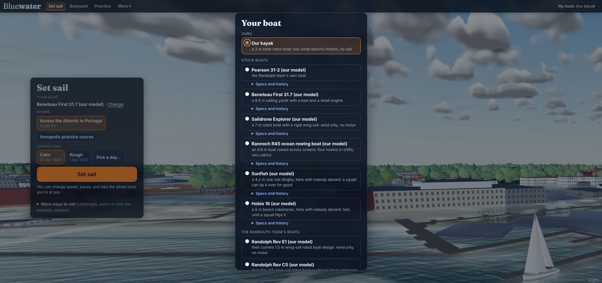
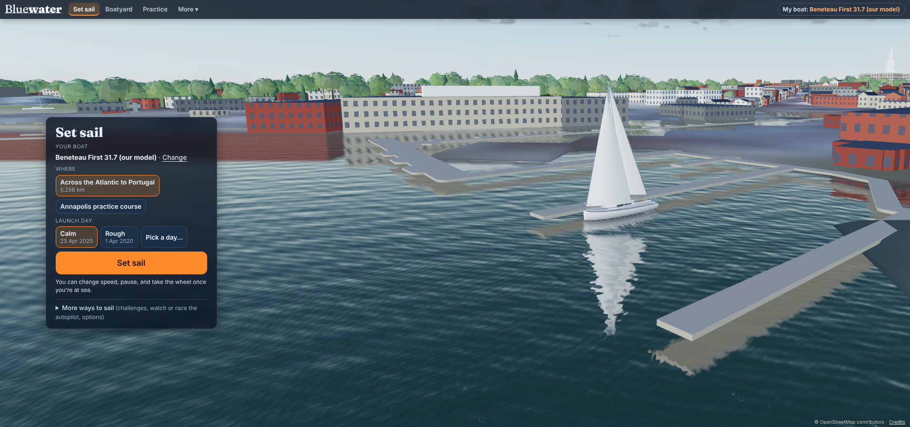

# The harbour behind the Set sail card: why it looked terrible, and a first pass (24 Nov 2026)

John, 24 Nov 2026, with a picture from his PC (Beneteau First 31.7, a 1911 x 898 window): "it looks
terrible." His picture: `screens/harbour-look-2026-11-24/before-johns-pc.png`.

The dock launch (#662) was checked only with the kayak, in a 1280 x 800 window, on cloud software
graphics at Low. None of what follows showed there. Lesson, also in project memory: a new first
screen is judged on John's PC, with a big boat and a wide window, before it goes live.

## What was wrong, and what this changes

| What John saw | Cause | Change |
| --- | --- | --- |
| The boat cut off in the bottom right corner | `dockView` moved the camera for the frame but did not refresh its matrices, so `frameBoat` placed the boat on screen through the last frame's camera. The slide ran to its limit (0.39 of the screen, both ways) for every boat; the kayak only looked right by luck of its small numbers | `camera.updateMatrixWorld()` in `dockView` (`sea3d/src/helm.ts`). The slide now settles at 0.18 across, 0.10 down: the boat at two thirds across, whole |
| Buildings standing in the water; a dark shiny slab for the shore | The ground shader darkens and glosses everything under 2.5 m as "wet rock". Right for a lava shore in the Azores; Annapolis's whole waterfront stands 1 to 2 m above the water | On a "plain" shore the wet band stops at 0.35 m and is not glossy (`sea3d/src/land/island.ts`) |
| Pale smears on the water near the shore | Ocean breakers and white wash are drawn along every shore, never less than a fifth of full strength | On a "plain" shore the white water fades out in a calm and comes back as the sea gets up |
| The pier a thick dark outline | Pier colour 0x6b5a48 read near black from across the harbour | Sun-bleached planks, 0xa39682 (`sea3d/src/land/town.ts`) |
| Looking down on the town like a map | The dock camera stood 1.7 times further back than at sea, at full height. A 9.5 m yacht put it 41 m away and 15 m up | 1.3 times back and 0.6 of the height (`DOCK_PULL`, `DOCK_LOW` in `sea3d/src/helm/dock.ts`, both by eye) |

## Pictures

Cloud pictures, software graphics, full shaders (`?gl=full`), Beneteau, 1911 x 898, taken with
`sea3d/tools/qa/harbour-look.mjs` (new; needs `tools/build_boats.sh` for the real boat models).

Before (main at f1d10dc; the boat picker is open in this one, the scene behind it is what matters):

After:

## Still wrong, and not measured

- The buildings are plain boxes with a window grid, and the ground between the piers and the
  buildings is still flat and dull. This pass removes the faults; it does not make the town handsome.
- She lies across the ends of small finger piers, not neatly alongside one.
- **Not seen on John's PC yet**, which is the test that counts. The cloud has no graphics card.
- No speed measurement. Nothing is added to draw (two shader edits, one colour, one camera
  placement), so the speed guard's counts should not move; the PR's checks say.
- Unit tests: 690 pass before and after.
