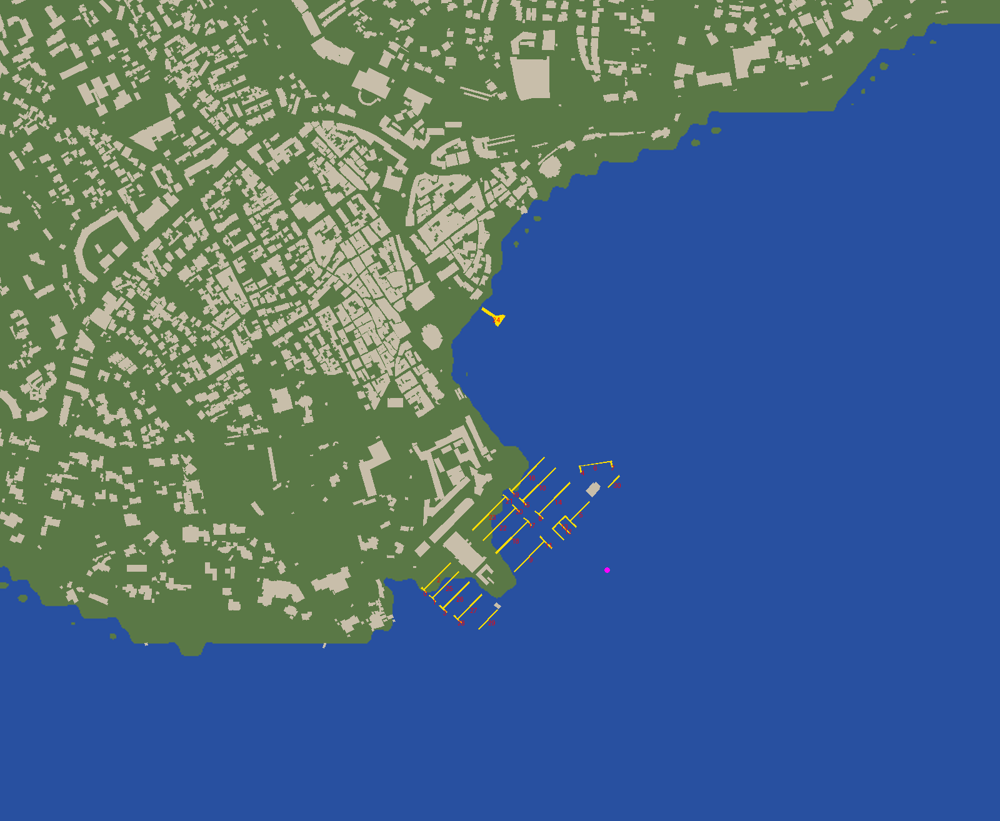
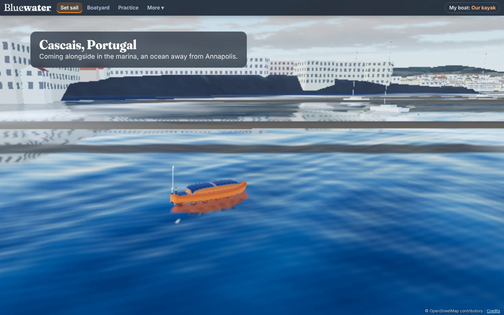
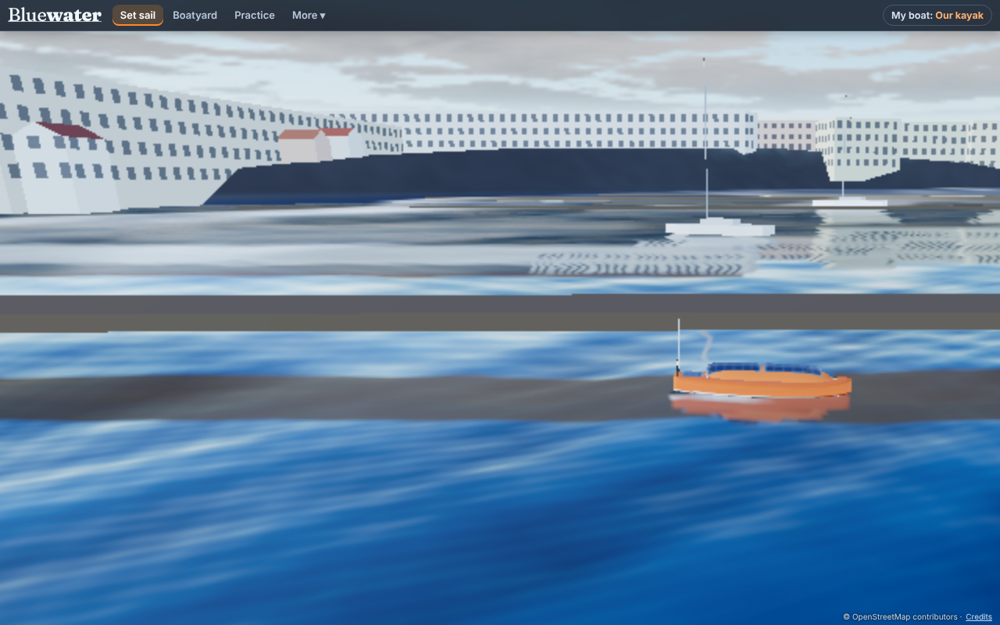

# Arriving at a dock in Portugal (24 Nov 2026)

John, 24 Nov 2026: "There doesn't seem to be enough land. You are just floating in the middle of
water the whole time." Asked which land to add to the crossing itself, he chose "Azores and a dock
in Portugal". This note covers the dock in Portugal. The dock launch at Annapolis is in
`dock-launch-2026-11.md`; the pass by the Azores is separate work.

## What changed

After a crossing finishes, the finish scene off Cabo da Roca plays as before. Then the view fades
to a card ("On to Cascais"), and she comes alongside a pontoon in the marina at Cascais, the harbour
town west of Lisbon, with the old town behind her. After 14 seconds (or a click or a key) the
results come up, with her still in view behind them.

**The finish rule is untouched** (John's decision of 9 Nov: the race's line, 39.5N 13.5W, about
330 km out to sea). Nothing here is simulated or timed. The clock has already stopped when the scene
starts, the simulator is not asked anything, and the words say so three times: on the cut ("Your
time stopped at the finish line, 330 km out to sea... This last part isn't timed or simulated"), and
in the results notes. Display only, like the leaving from Annapolis.

- `sea3d/src/helm/dock.ts`: `LANDING_WAY` (the last 40 m to the pontoon), `LANDING_LOOK`,
  `LANDING_S`, and a stopping mode for `Dock` (she slows for her berth and never passes it).
- `sea3d/src/helm.ts`: `landingScene()` after `arrivalScene()`; the frame takes her place, heading
  and speed from the landing, with the harbour's small chop; the camera holds one compass bearing
  (315 degrees, towards the town) all the way in.
- `sea3d/helm.html`: the cut's and the banner's words.
- `sea3d/src/land/place.ts`, `town.ts`: the Lisbon place now has a town, `cascais`, drawn in
  whitewash and pale washes under terracotta tiles (GUESS, by photographs) where Annapolis is brick.
- `src/boatsim/oceandata/landviews.py`: the Annapolis bake became `bake_town`, with `cascais` as a
  second town. `tools/build_site.sh` fetches `cascais*`; `landdata.yml` bakes it by default.

## The town's data

Baked on 24 Nov 2026 from Overture Maps release 2026-10-21.0 (OpenStreetMap; ODbL) and AWS Terrain
Tiles at zoom 15, for the box 9.432W to 9.404W, 38.686N to 38.704N:

| | |
| --- | --- |
| Buildings | 3,623 |
| Piers | 31 (the marina's pontoons and the town pier) |
| Ground grid | 800 x 657, about 3 m apart, heights -3.2 to 58.9 m |
| `cascais.json` | 0.86 MB |
| `cascais_height.bin` | 1.05 MB |

Only the buildings and piers whose boxes meet that box were read from the public bucket (a filtered
read, not a bulk download). The marina's stone breakwaters are not in the data (they are not mapped
as piers), so the pontoons stand in open water. Building heights are Overture's where it has them
and a GUESS by footprint (7, 10 or 13 m) elsewhere, as at Annapolis.

Her berth is half way along `piers[9]`, the outer pontoon (104 m long, 2.4 m wide), on its bay side.

## How it was measured

`sea3d/tools/qa/portugal-dock.mjs` plays the finish scene and the arrival in a headless browser
(software graphics, Low, 1280x800) with the baked files in `sea3d/public/land/`, and checks:

| Check | Result |
| --- | --- |
| The town loads behind the cut and the scene starts | yes; 3,623 buildings shown |
| She reaches the end of the way and stops | yes, at 38.691785N 9.417153W |
| Distance from her centre line to the pontoon's edge | 2.0 m (3.2 m from its centre line) |
| Unit tests (`npm run test:unit`) | 686 pass before, 687 pass after (one new: arriving) |
| Python tests (`tests/test_oceandata_landviews.py`) | 10 pass before, 11 after (one new: `bake_town`) |

Timing, from `Dock` itself (the new unit test): at our kayak's 1.5 m/s she covers the 38 m in about
30 s, slowing over the last 9 m. The scene hands over to the results after 14 s, so she finishes
coming alongside behind the card.

Without the town's files (any copy of the site built before `cascais*` is on the `land-data`
release), `landingScene` asks for `cascais.json` first, finds none and returns before anything is
shown: the results come up off Cabo da Roca exactly as before (measured: 0.4 s, no dark card).
`?dock=0` also skips it.

Cloud pictures, software graphics at Low (jagged; the real thing is smoother):

## After an independent review (24 Nov)

A second reader went through the change. Six findings; four fixed, two left and noted.

| Finding | What was done |
| --- | --- |
| The automatic step down to Low was timing frames in the harbour (it is switched off at the Annapolis dock, because a town is heavier than the sea). | Switched off while she is at Cascais too. |
| On a site without the town's files, every finish showed 8 s of dark card promising Cascais, then Cabo da Roca. | The scene asks whether `cascais.json` exists before showing anything; without it there is no card (0.4 s, measured). The wait also ends as soon as the land's detail has loaded, town or no town. |
| The town loaded wherever the Lisbon place is used: "Watch from: Cascais", `voyage.html?place=lisbon`. 1.9 MB and 3,623 buildings for a whole watched voyage, with moored boats standing in the open sea's swell. | The Lisbon place's town is `townOnAsk`: it loads only when the landing asks for it (`NearbyLand.askTown`). Those pages are as they were. |
| In the harbour the wind, lean, rain and spray were still the finish line's last hour: a yacht could arrive heeled in a gale over a 0.1 m chop. | While she is at Cascais the frame takes nothing from the finished voyage, as at the Annapolis dock: upright, no rain, the harbour's chop. The light is the launch day's noon. |
| A sideways drag does nothing during the scene and behind the results (the view holds its compass bearing), and a phone's step back is not applied. | Left: the Annapolis dock behaves the same way. To look at on a real phone. |
| The banner said "an ocean away from Annapolis" for any start, and the scene ignored the reduced-motion setting. | The banner now says "Coming alongside in the marina. The crossing is done." With reduced motion she is alongside at once. |

## Not measured, and to check by eye on a real graphics card

- The frame rate in the harbour and the wait behind the cut on John's GTX 1660 Ti. The cloud has no
  graphics card; a full-quality run here drew too few frames to play the scene at all.
- The town's shaders build at the finish, behind the cut. That is after Set sail, but long after the
  speed guard's `sailProgramsAfterSetSail` window (the first seconds of a voyage), which this does
  not touch. Counts on the runner are unchanged by this PR because the runner has no Cascais files
  until the land data is published.
- The shore between the water and the first buildings draws dark at Low. It may want the plain shore
  the Annapolis place uses; left alone here because the same land is the finish scene's cape.
- Whether 14 s is the right length, and whether the camera should stand closer to the pontoon.

## To put it on the live site

1. Merge this change.
2. Run the "Land data" workflow with places `cascais` and publish on: it adds `cascais.json` and
   `cascais_height.bin` to the `land-data` release (the other files are left as they are).
3. Run the "3D sea page" deploy again so the site build picks them up.
