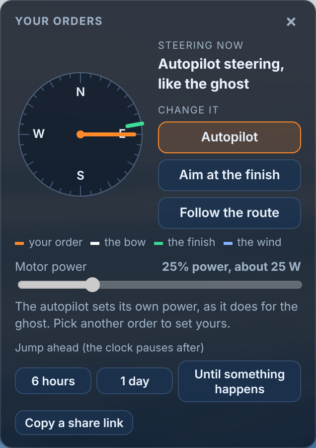

# Set sail card: what was left of issue #314

21 Nov 2026. Issue #314 listed four things from Nina's first-time player pass (11 Nov) that
the start-card rework did not cover. The card has been rebuilt since (#432 onward), so each
was checked on a local build of main (f596eba) at 1400x900.

| Item | State on main | What this change does |
|---|---|---|
| 3. Launch day and weather challenge fight each other | Gone. The card has one "Launch day" choice (Calm, Rough, Pick a day); nothing overrides it quietly. | Nothing needed. |
| 4. "Start from" reads like a data dump | Fixed on screen: the list shows port names only, and one line under it gives the distance after you pick. The old long label ("Annapolis, launched 233 km out by water at ...") was still in the code, used by nothing but its own tests. | Removed the unused `portLabel` so it can't come back; its tests now check the name and the one-line hint. |
| 6. The orders panel says the same thing three ways | Still there: the bold line said "Straight at the finish" beside a button "Aim at the finish", with nothing to say which was a label and which a button, and the compass's four coloured lines were only explained in a hover tip. | See below. |
| 9. The forecast panel is half-covered by the start card | Gone. Nothing shows behind the card before the start. | Nothing needed. |

## The orders panel now

- A small heading "Steering now" over the bold line, and "Change it" over the buttons, so the
  label and the buttons can't be mistaken for each other.
- The bold line uses the button's own words: "Aiming at the finish" (was "Straight at the
  finish") and "Following the route" (was "Following the autopilot's route"). "Steering 075°"
  and the autopilot line are unchanged.
- "Aim at the finish" has a hover tip like the other two: "Points her straight at the finish
  line".
- A key under the compass names its four lines: your order, the bow, the finish, the wind.
  When watching a recorded voyage the existing three-line key is used and this one is hidden.

The Set sail card as checked:

## How it was checked

- `npm run test:unit`: 630 pass.
- By eye on a local build. The cloud build has no simulator files, so the panel was opened
  without a voyage running; the wording after pressing each button comes from the code, not
  from a played game.
- Words and layout only: no new drawing, so the speed guard's counts don't move.

## Still open on #314

Its "done when" is Nina playing it live as a first-timer. That needs a person on the live
site after the deploy.
