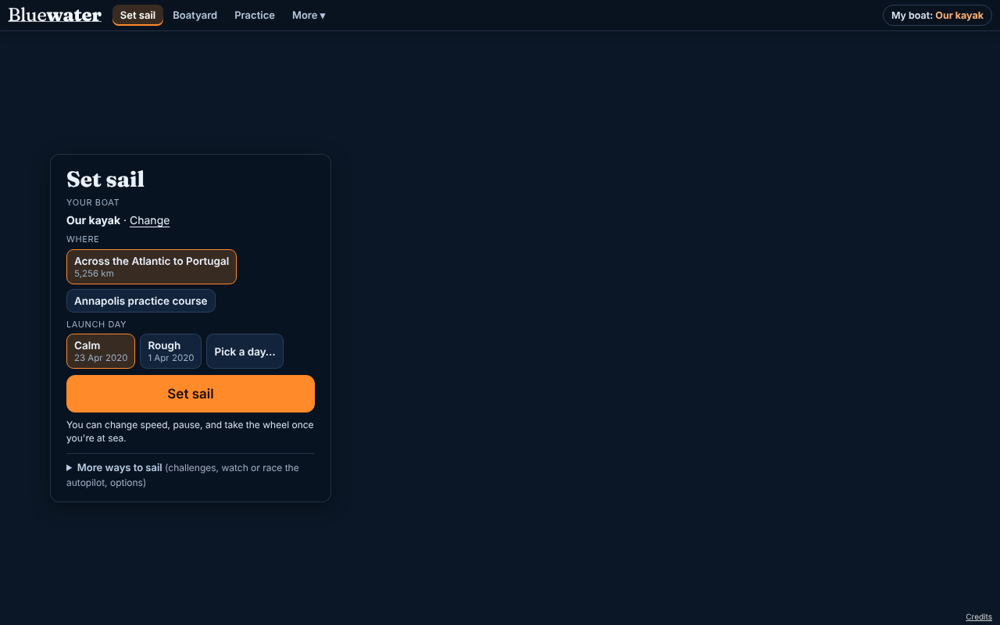
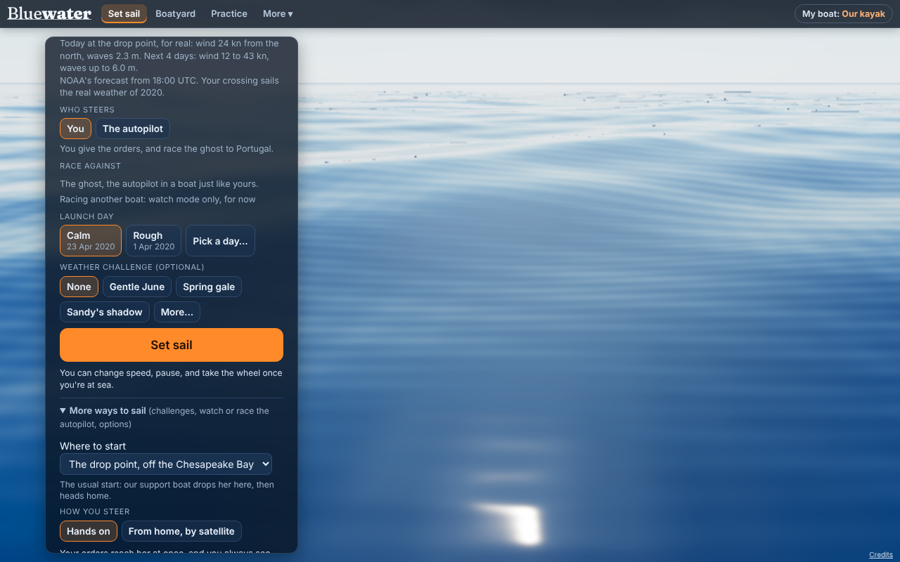
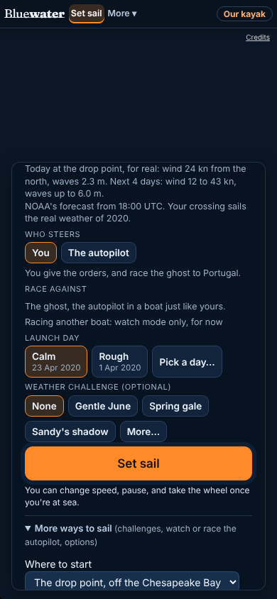

# The short Set sail card, 24 Nov 2026

## Why

John, 24 Nov 2026: the design "is overly complicated". The Set sail card was the first place a
new player met that: before sailing it asked where, who steers, who to race against, the launch
day and a weather challenge, showed two lines about today's real weather at the drop point, and
had "More options" under the button. Six groups of choices for someone who wants to sail.

## What changed

The first view of the card asks three things: your boat, where, and the launch day. Then Set sail.

Everything else waits behind the one disclosure at the foot of the card, now called "More ways to
sail (challenges, watch or race the autopilot, options)". It was "More options". Opening it shows
who steers, race against, the weather challenges and today's weather in their old places above,
and the port, how you steer, breakdowns and the battery below, as before. Once opened they stay.

A link that already picks one of them (Watch a voyage, Race it, a challenge link) opens with the
rows showing, so nothing a link chose is hidden. Annapolis practice is unchanged.

Nothing was removed from the game, and every default is what it was.

| | Before | After |
|---|---|---|
| Card height at 1280x800 | 736 px (it scrolled) | 447 px |
| Groups of choices before Set sail | 6 | 3 |

Opened:

## Where the code is

- `sea3d/src/helm/setsailCard.ts`: `extras` and `simple` in `draw()`; the disclosure's `toggle`
  listener sets `extras`.
- `sea3d/helm.html`: the summary's words; the places the card held open for the hidden rows while
  it filled in (`ss-filling`) are gone, so the card doesn't open tall and then shrink.
- `tools/live_site_check.mjs`: the Dorian check opens the disclosure before it presses the pill.
- `tools/playtest/play.mjs`: the card's click-speed measure presses the launch day pills (Calm,
  Rough) in place of the who-steers pills, which a first view no longer shows.

## Checked

Cloud sandbox, software graphics, a local build. Unit tests: 668 pass. The rows hidden on the
short card and shown once opened were read from the page (`getClientRects`), and the two pictures
above are from that run. Not run here: the full playtest and live site check, which run on the PR.

## After an independent review (24 Nov)

A second reader went through the change and found three faults. All three are fixed, and
`sea3d/tools/qa/short-set-sail.mjs` now checks them at a desktop window (1280x800) and a phone's (390x844).

| Fault | Before | After |
| --- | --- | --- |
| Opening "More ways to sail" scrolled the card down to the options, past the rows it had just shown (Who steers, Race against, today's weather). The first opened picture in this note showed it: the card began at "Launch day". | First shown row out of view | The card scrolls to the first row it has just shown (picture below, retaken) |
| A link that shows the rows (`?who=autopilot`, or a challenge link) lost them the moment you pressed "You" or "None", so there was no way back without finding the disclosure. | Rows vanish under the click | Rows once shown stay for that visit |
| Rows that arrive late (her recorded voyages, today's forecast) pushed an already open "More ways to sail" down without fitting it to the window again. | Not refitted | Refitted after each late row |

`sea3d/tests/smoke.mjs` used to say the plain card shows Who steers; it now checks that the plain card
hides it and that opening "More ways to sail" shows it with "You" picked.

Script output, both windows: the plain card opens short (447 px desktop, 426 px phone), opening shows
who, rival, challenges and today with the first in view, and `?who=autopilot` then "You" keeps Who steers.

