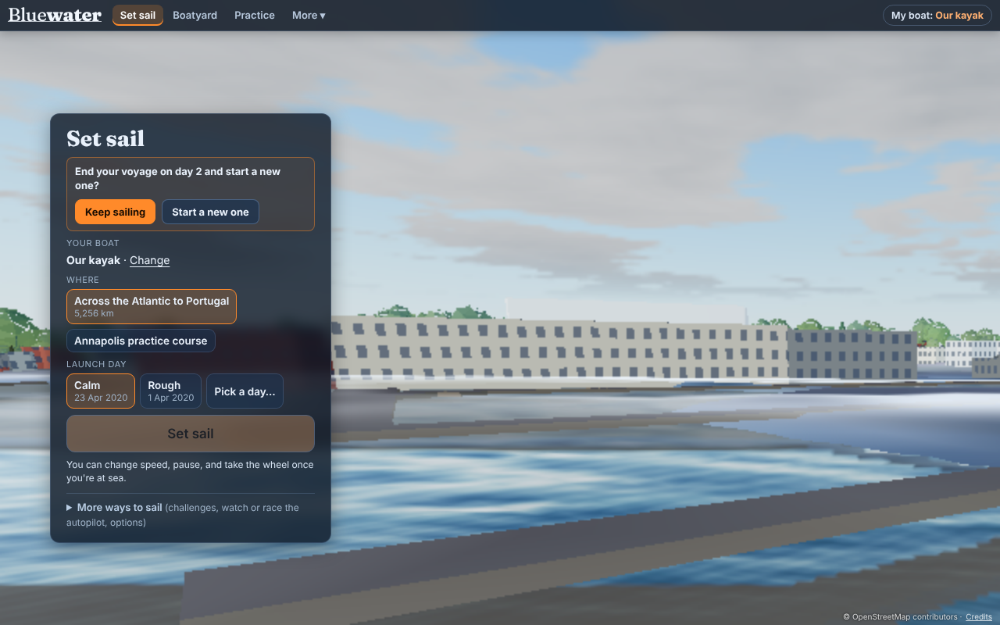
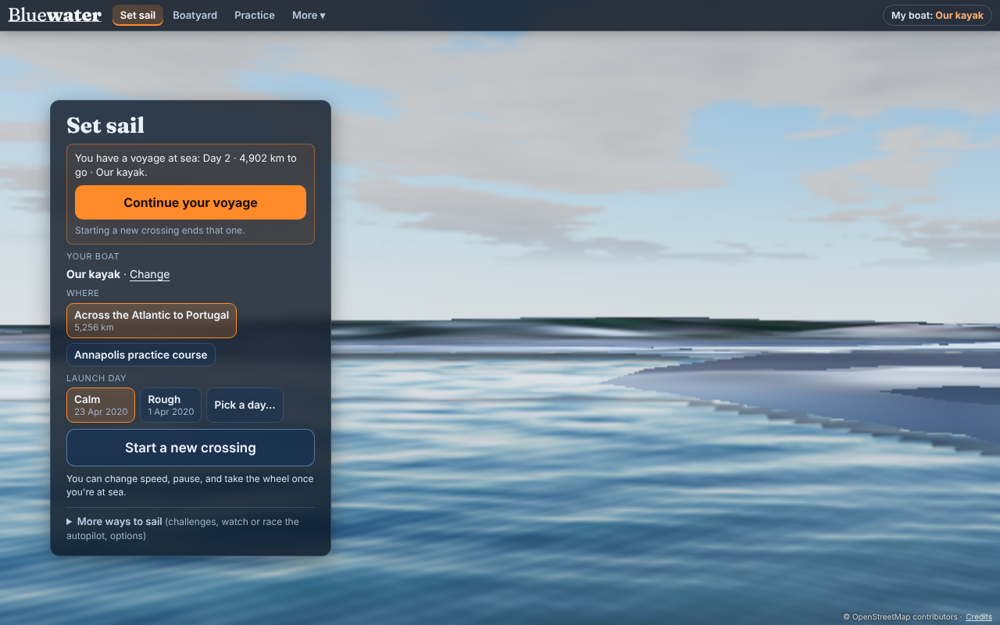
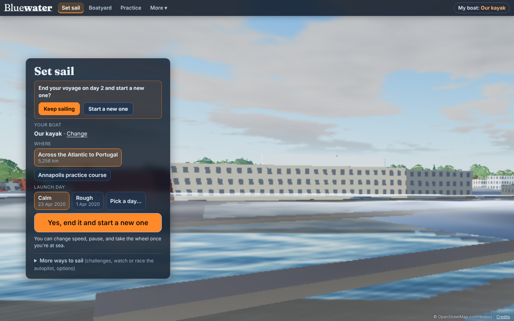

# Set sail with a voyage at sea: never a dead button (24 Nov 2026)

John, 24 Nov 2026, with a picture of the Set sail card: "So this doesn't start and it looks terrible."
This note is the "doesn't start". The harbour's look is a separate job.

## What happened

His browser had a voyage of his at sea (day 7). Since #465, pressing Set sail in that state does not
start: it shows a small question in the box at the top of the card ("End your voyage on day 7 and
start a new one?", Keep sailing / Start a new one) and **dims the Set sail button** to 40%. To a
player who pressed the big button, the big button going grey reads as "broken". Pressing it again
did nothing.

Reproduced in a cloud browser with the real simulator: sail two days, open the card again, press
Set sail. "Start a new one" itself did work (the crossing started 25 s after the press, most of it the
simulator loading), so nothing was truly stuck; the card just did not say so.

## What changed (`sea3d/src/helm/setsailCard.ts`, `sea3d/helm.html`)

| | Before | After |
| --- | --- | --- |
| Card with a voyage at sea | A small orange link "Continue your voyage"; the big orange button says "Set sail" | "Continue your voyage" is the big orange button; the start button is plain and says "Start a new crossing" |
| One press of the start button | Question appears, the button goes grey | Question appears, the button turns orange and says "Yes, end it and start a new one" |
| A second press of it | Nothing | Starts the new crossing (same as "Start a new one") |
| Ever dimmed | Yes | No |

The one question before ending a voyage stays (it cannot be undone). Without a voyage at sea nothing
changes: the button says "Set sail" and starts at once.

## Checked

`sea3d/tools/qa/start-with-saved-voyage.mjs` (new) plays it in a headless browser with the real
simulator: eight checks, all pass (labels, not dimmed before or after the press, the question, a
double click counting as one press, the second press starting the crossing, the old voyage gone). Unit tests 690 pass before and after. Cloud pictures, software
graphics at Low:

An independent review found two things, both fixed: a double click (or Enter held down) would have
asked and answered in one go and ended the voyage unread, so the yes now counts only 0.7 s after the
question appears and never on the second click of a double click; and the question is now announced to
screen readers (`role="alert"`, and the button points at it).

Not checked: on John's PC, and with his Beneteau (the path is the same for every boat).
